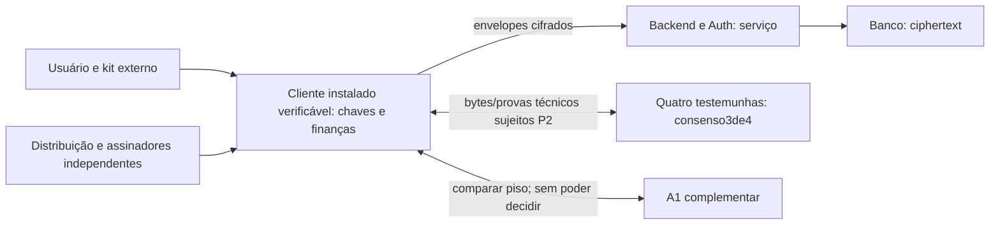

# Security05.2 — arquitetura E2EE e cliente verificável

Estado: REVISION_PENDING_INDEPENDENT_REVIEW; segurança e integração NOT_PROVEN. Decisões vigentes em PRODUCT_DECISION; especificação de consenso em SYNC_AND_INTEGRITY. Requisitos anteriores não substituídos permanecem, especialmente P1 E2EE e P2 vínculos privados cifrados.

## Fronteiras e direção selecionada

Cliente instalado/assinado/verificável, com distribuição independente do backend, desbloqueia chaves localmente, descriptografa, valida semântica/completude e calcula finanças. Backend/Auth oferecem sessão, transporte e quotas de serviço; banco armazena bytes opacos e aplica defesa de acesso comum. Nenhum deles possui plaintext financeiro, DEK, S/U ou root privada/recovery. JWT não admite dispositivo nem recupera chaves.

Quatro testemunhas, quatro domínios/operadores independentes, consenso Basic HotStuff4/q3: atestam ordem/bytes/contexto e autorizações técnicas verificáveis, nunca valor privado. A1 é piso complementar independente e comparação entre dispositivos; não serializa nem substitui consenso. A3 é distribuição/update confiável separada. Essa direção substitui os candidatos alternativos de Security05.1:2-de-3 simples refutado e A1 ativa não são fallbacks vigentes.

## Contratos e evidências

SYNC define COMMAND/NODE/CONFIG/VOTE/QC/READ_BARRIER/PROOF, guardas F02, locks persistentes, fases, pacemaker e handover. KEY define S/U32B, sharing, HKDF e wrapping GCM. São perfis propostos baseados em primitivas/protocolo publicados; bibliotecas, interop, refinamento, prova e execução permanecem pendentes.

Conteúdo, relações entre registros e dependências financeiras ficam cifrados. Canal/N/signers/config/compromissos/frequência ainda podem revelar atividade e vínculos. A lista técnica não aprova exposição: P2 requer inventário e autorização específica de índices/metadados adicionais; não inventar ZK ou hash público de valor para alegar privacidade. Sem representação demonstrável que concilie verificação de autoridade/continuidade e P2, integração bloqueada.

## A3 — perfil candidato de update instalado

Base publicada para metadados de atualização: [The Update Framework specification1.0.37, §§4–6](https://theupdateframework.github.io/specification/latest/), consultada2026-11-04. TUF separa root/targets/snapshot/timestamp, verifica cadeia e expiração, protege versões e vínculos de hashes; rotação de root usa limiares antigo e novo, em versões consecutivas. A segurança publicada não prova nosso bootstrap, aplicativo, OS, pipeline ou política de expiração.

### Confiança inicial e responsabilidades

O primeiro instalador e updater precisam de autenticidade fora da origem backend ameaçada: pacote assinado por chave de distribuição independente e raiz/fingerprint de root metadata obtida por canal externo já autenticado (por exemplo provisionamento confiável/cerimônia verificada pelo usuário), além das verificações da plataforma. Baixar JS/instalador/root somente do backend e confiar em sua autoassinatura não resolve bootstrap. O mecanismo externo/plataformas e sua UX ainda precisam ser escolhidos e comprovados: **A3-BOOT OPEN/BLOCKED** antes de considerar o cliente apto a plaintext.

Root de distribuição é domínio diferente de roots de dados, recuperação, configuração de testemunhas e Auth. Build/CI não detém sozinho as chaves de root/targets; backend pode espelhar artefatos/metadados mas não assinar release válido. Reprodução/verificação independente do build e revisão do código ajudam contra pacote malicioso validamente assinado, porém exigem evidência própria. Browser/PWA dinâmica atual, HTTPS/CSP/SRI ou uma assinatura isolada não equivalem ao perfil.

Cobertura obrigatória do conjunto verificado: TODO código ativo no contexto com acesso a plaintext, chaves, shares/U ou ponte privilegiada deve integrar o artefato/manifest de release aprovado e ter bytes/dependências cobertos pela verificação. Isso inclui JS, WASM, workers, plugins, bibliotecas, webviews e templates executáveis, além do binário/updater. O backend é fonte somente de dados não executáveis nesse contexto: nenhuma resposta/configuração pode introduzir ou selecionar código fora do conjunto verificado, por URL, eval, módulo remoto ou wrapper que carregue a interface financeira da origem comprometida. Conteúdo remoto não pode receber plaintext/chaves nem uma ponte para essas capacidades. Configuração pode parametrizar comportamentos já verificados, sem contornar a seleção de código autorizada. Essa norma fecha uma dependência de confiança explícita; não prova ausência de RCE, bugs de parser ou código malicioso validamente autorizado, que exigem análise e evidência próprias.

### Metadados, estados e parâmetros propostos

Target metadata candidata liga caminho canônico/plataforma/arquitetura, hash e comprimento dos bytes, versão do app/updater, versão mínima de protocolo/codec/config e identificação de release/revisão independente. Targets nunca contêm chaves ou dados financeiros. App updater mantém versão/hash instalados, metadados TUF confiáveis, mínimos locais de versão/epoch, relógio de validação e estado VERIFIED/STAGED/ACTIVE/REVOKED. Artefato é baixado com limite, verificado antes de instalação e ativado atomicamente; falha preserva último cliente verificado sem acionar downgrade financeiro.

Parâmetros candidatos ao CEO, NÃO configurações aprovadas: root2-de-3 offline e targets2-de-3 em custódias separadas do backend/CI; snapshot/timestamp com chaves distintas e função online restrita, sem poder assinar targets. Expirações ilustrativas a deliberar: timestamp48h, snapshot7dias, targets30dias, root365dias. Nenhum desses números constitui SLA, aceite de risco ou criação de operadores; dimensionamento offline, acessibilidade e resposta a incidente podem exigir outros parâmetros com decisão explícita.

Um adversário que comprometa apenas o backend/mirror, Auth ou chave online de timestamp não pode produzir target novo válido se roots/targets e o cliente corretos permanecerem íntegros. Pode negar serviço e reter updates; expiração precisa de relógio confiável. Compromisso do limiar de targets pode autorizar pacote malicioso com assinatura válida; compromisso de root acima do orçamento pode substituir confiança. TUF não verifica a benignidade de código assinado nem elimina risco de SO/dispositivo comprometido. Esse orçamento A3 e threshold/custódios precisam de aprovação específica; o f1 das testemunhas não se transfere automaticamente ao release.

### Sequência de update e anti-rollback

Cliente inicia uma tentativa com instante fixo e tempo confiável suficiente; carrega root persistida; percorre rootN→N+1 com autorização dos limiares antigo E novo; valida timestamp, snapshot e targets, versões/hashes/comprimentos/expirações, sem misturar gerações; então verifica artefato/plataforma e política de mínimo e ativa atomicamente. Assinatura antiga correta ou hash vindo do mirror não ultrapassam mínimos/expiração. Root antiga expirada pode servir para verificar cadeia de novas roots conforme a spec, mas não autoriza target ativo antigo sem demais checks.

Persistir metadados/mínimos antes de ativar ou expor dados ao novo binário; em rollback/restore/clonagem local ou dúvida de relógio, não inferir release atual de metadados velhos. Exigir atualização verificável ou recuperação externa do mínimo confiável; loginAuth não reseta versão. A3-STATE (armazenamento anti-rollback/tempo por plataforma) permanece aberto; uma assinatura/MAC local só detecta alteração, não replay de backup autêntico.

Rollback operacional do app só para target ainda autorizado, não revogado, compatível com mínimos de protocolo/segurança e estado financeiro já aceito; requer release explicitamente autorizado de recuperação, nunca reinstalar artefato antigo porque “já foi assinado”. Regras de dados/épocas não retrocedem com software. P5 permite consulta de snapshots locais já verificados e rascunhos; isso pressupõe cliente conhecido íntegro, não autoriza executar binário revogado ou origem maliciosa. Na falta de frescor de update, cliente mostra versão/última verificação e limita ações conforme política offline; parâmetros dessa compatibilidade não podem reduzir P5 nem dispensar integridade do binário.

### Rotação e incidente

Rotação normal de root distribui todas as versões intermediárias assinadas pelos limiares anterior e novo; verificação não usa root substituída por backend. Para chaves de release/online comprometidas, root válida restringe funções/substitui chaves e novos metadados atualizados revogam targets conforme política de compatibilidade; conservar registro de incidentes sem plaintext. Se root threshold foi perdido/comprometido e não há cadeia confiável, fluxo normal de rotação não recupera confiança sozinho: congelar distribuição/plaintext em clientes afetados e exigir reprovisionamento externo autenticado com decisão CEO.

Nó/cliente que já executou pacote malicioso pode ter exposto dados/roots; atualizar o software não revoga conhecimento. Resposta exige classificar possível exposição, revogar devices/chaves, rotacionar conforme R35 e validar histórico/estado por consenso, mantendo limites do legado. Operadores de distribuição e testemunhas não podem compartilhar credencial/root de administração que invalide independência.

## Limites e fechamento

Admin SQL ainda insere/apaga bytes; objetivo é não aceitar efeito econômico indevido, não impedir escrita bruta. Witnesses não validam moeda/valor ocultos. Sem dados completos ou prova de consenso/lineage/atualidade, cliente não anuncia saldo atual. Assinatura não prova intenção humana; AEAD não prova frescor; recuperar roots não recupera locks/época atual.

Q-PACE/Q-RECOVER/Q-RECONFIG/Q-BOOT e A3-BOOT/A3-STATE/parametrização são bloqueios materiais identificados, não uma declaração de impossibilidade universal. Toda a adaptação precisa de prova/refinamento independente; ensaios, independência operacional, custos totais, UX, paridade e compatibilidade hospedada permanecem NOT_PROVEN. Nenhum Security06/implementação liberado.
