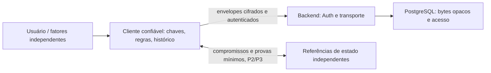

# Security05 — arquitetura E2EE condicionada

Estado: desenho proposto sob políticas executivas P2–P6 aprovadas; eficácia e protocolos NOT_PROVEN. Revisão independente concluída em [INDEPENDENT_REVIEW.md](INDEPENDENT_REVIEW.md), com Q23/R35 abertos e sem aprovação dos protocolos. Esta linha recebeu somente atualização editorial posterior ao parecer. Requisitos/status exatos em [PRODUCT_DECISION.md](PRODUCT_DECISION.md).

## Fluxo e fronteiras

O diagrama descreve responsabilidades propostas, não serviços existentes ou desenho aprovado. P2 exige cifrar conteúdo financeiro e relações privadas; campos de transporte/Auth inevitáveis precisam ser inventariados/minimizados e nenhuma exposição financeira/índice adicional é autorizada por este diagrama. A interface com referências não transporta valores ou chaves privadas. P3/P6 fixaram metas de independência cuja realização permanece NOT_PROVEN.

| Componente | Responsabilidade proposta | Não pode ser autoridade isolada para |
| --- | --- | --- |
| Cliente confiável | Autorizar intenção, verificar dispositivos, descriptografar, validar eventos e dependências, calcular projeções exatas, validar estado aceito | Provar frescor global apenas com seu cache ou relógio |
| Backend | Autenticação do serviço pelo JWT, quotas, persistência/sincronização opaca, idempotência de transporte | Saldos, validade semântica, raiz criptográfica, recuperação |
| PostgreSQL/Supabase | Persistir ciphertext; RLS/grants/owner para acesso comum, transação de bytes | Confidencialidade contra administrador, legitimidade de eventos, histórico atual |
| Auth | Identidade e sessão de serviço | Admitir dispositivo, recuperar DEK ou substituir raiz |
| Âncoras/testemunhas propostas | Atestar compromissos, continuidade/ordem conforme protocolo futuro | Validar valores ocultos; garantir disponibilidade contra toda colusão |

## Combinação arquitetural escolhida como objetivo executivo

A1: cliente com referência de estado guardada pelo usuário em dispositivo/domínio separado. Menos infraestrutura, mas perda/indisponibilidade da referência suspende novas confirmações. Vários dispositivos exigem coordenação que ainda não foi especificada.

A2: clientes verificadores e serviço de testemunhas com operadores/credenciais/distribuição separados. P3/P6 fixam meta inicial de três testemunhas em três domínios/operadores efetivamente independentes, quórum dois, tolerando backend+admin SQL+Auth+até uma testemunha comprometida conjuntamente. Isso exige protocolo analisado para publicação, consistência, rotação, admissão e recuperação. Várias assinaturas não constituem consenso por si só; a regra de contagem isolada é insuficiente para a meta, conforme contraexemplo Q23 em SYNC_AND_INTEGRITY.md.

A3: cliente instalado, assinado e verificável, com distribuição/update protegidos independentemente do backend, exigido para operações com plaintext. Combinado com A1 e A2, não como opção dispensável. Uma PWA entregue pela mesma origem comprometida não equivale a esse isolamento.

Decisão vigente: objetivo A2+A1+A3 aprovado como política; as alternativas isoladas descritas na proposta anterior não são escolhas equivalentes ainda abertas. O protocolo que realiza essa composição continua proposto/NOT_PROVEN e bloqueado para aprovação técnica enquanto Q23 e demais obrigações não forem resolvidos. A referência pessoal A1 não corrige automaticamente a interseção maliciosa dos quóruns: requer papel normativo explícito, coordenação entre dispositivos e bootstrap confiável. Não mudar silenciosamente para quatro testemunhas/3-de-3 nem dispensar A1/A3. A antiga arquitetura híbrida com montantes legíveis no servidor é incompatível com P1.

## Contratos conceituais, ainda não normativos

Uma unidade lógica carrega conteúdo cifrado com autorização de dispositivo, identidade única de comando, versão de protocolo/regras, época de chaves, vínculos de dependência e compromisso do estado anterior. Owner, audiência e contexto de uso devem ser vinculados criptograficamente para impedir transplante. Relações privadas permanecem cifradas; publicar grafo de dependências, identificadores correlacionáveis ou compromissos pode revelar vínculos e exige análise P2 e autorização específica antes de exposição. Owner/roteamento Auth e comprimentos inevitáveis não justificam expor relações financeiras. Viabilidade de provas verificáveis por testemunhas sem revelar esse grafo é obrigação técnica ainda aberta.

O cliente só promove uma unidade a efeito financeiro após conferir proveniência, autorização válida, completude e ordenação relevantes, referência atual e semântica. Persistência/ACK HTTP não é confirmação financeira. Ver [sincronização](SYNC_AND_INTEGRITY.md) e [motor](CLIENT_FINANCIAL_ENGINE.md).

Suíte criptográfica, serialização canônica, domínio de assinatura, AAD, geração de nonce, limites de tamanho e versionamento devem ser especificados e revisados antes de implementar. Não inventar criptografia nem selecionar biblioteca neste gate. Autenticação de envelope não demonstra completude, intenção humana ou frescor.

## Cliente e distribuição

Código malicioso entregue pela origem pode ler plaintext exibido e pedir uso de chaves não exportáveis. HTTPS, CSP, SRI ou hash fornecidos pela mesma origem ajudam em ameaças específicas, sem resolver o controle dessa origem. A política vigente exige cliente instalado, assinado e verificável com distribuição/update independentes; aceitar JS malicioso da própria origem foi excluído como tolerância silenciosa. Raiz inicial, assinadores, atualização, recuperação/revogação e verificação independente da distribuição precisam de desenho e prova. O frontend web dinâmico atual não é automaticamente confiável para operações com plaintext.

O futuro desenho de releases deve tratar build reproduzível, controle de assinatura separado do CI/servidor, autenticação inicial da raiz, anti-downgrade, revogação, rollback seguro da aplicação sem rollback do histórico e resposta a comprometimento. Nenhum desses controles foi implementado ou demonstrado. Navegador/SO/dispositivo comprometido pode expor dados em uso; E2EE não remove esse risco.

## Limites

Administrador pode apagar bytes, negar serviço e inserir SQL arbitrário. A proposta busca impedir que o cliente aceite efeitos financeiros adulterados, não impedir toda escrita bruta. Sem referência recente confiável, um histórico antigo autêntico pode ser indistinguível do atual; P5 bloqueia confirmação, saldo atual e Safe to Spend válido e permite somente histórico local previamente verificado/datado e rascunhos cifrados não confirmados. Backups antigos e leitores anteriormente autorizados não perdem conhecimento por rotação posterior. Limites explícitos: dispositivo/SO ou assinatura de distribuição comprometidos, duas ou mais testemunhas em colusão, perda de todas as referências, indisponibilidade e metadados. Não há resistência absoluta demonstrada. Compatibilidade hospedada, independência real, custos e UX instalada estão NOT_PROVEN; inviabilidade bloqueia lançamento, sem reduzir a política.
